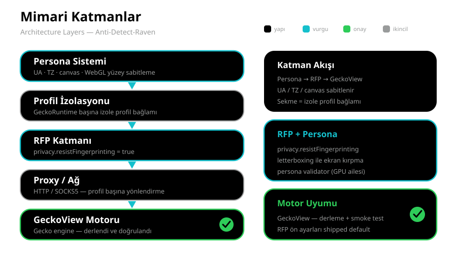

<div align="center">



# Anti-Detect-Raven 🐦‍⬛

**GeckoView tabanlı, açık kaynak anti-detect Android browser**

`Iceraven / Fenix fork'u` · `MPL-2.0` · `v0.1.0-adr`

</div>

---

> **Not:** Google'ın 2026/2027 gerekliliği (sertifikalı cihazlarda geliştirici kimlik doğrulaması) sonrası bu uygulama sertifikalı Android cihazlarda çalışmayabilir. Detay: [keepandroidopen.org](https://keepandroidopen.org)

## Ne bu? / What is this?

**Anti-Detect-Raven**, [Iceraven Browser](https://github.com/fork-maintainers/iceraven-browser) (→ [Fenix](https://github.com/mozilla-mobile/firefox) / GeckoView) üstüne kurulu bir anti-detect browser'dır:

| Katman | Ne yapar? |
|---|---|
| 🦎 **GeckoView motoru** | Motor-seviyesi müdahale mümkün (Tor Browser Android ile aynı yol) |
| 🛡️ **RFP** | Gecko'nun gömülü `privacy.resistFingerprinting` anti-fingerprinting katmanı |
| 🎭 **Persona sistemi** | Gerçek cihaz donanımına dayalı, tutarlı cihaz kimlikleri (validator'lı) |
| 🗂️ **Profil izolasyonu** | Profil başına ayrı runtime/cookie deposu + proxy |
| 🔌 **Proxy** | HTTP / SOCKS5, profil başına |



## Kurulum / Install

### 1. APK indir

[Releases](../../releases) sayfasından cihazına uygun APK'yı indir:

| APK | Cihaz |
|---|---|
| `app-arm64-v8a-forkDebug.apk` | Modern telefonlar (çoğu cihaz) |
| `app-x86_64-forkDebug.apk` | Emülatör / x86_64 |
| `app-armeabi-v7a-forkDebug.apk` | Eski ARM cihazlar |

> APK'lar **debug-signed** alpha kalitesindedir. Birincil tarayıcın olarak kullanma.

### 2. Kendin derle — adım adım

```bash
# 1) Fork'u klonla
git clone https://github.com/Tandarke12345560/anti-detect-raven.git
cd anti-detect-raven

# 2) Android-components vendor olarak repoda; derleme ortamını hazırla
bash automation/iceraven/patch_android_components.sh

# 3) Python venv + glean parser (glean metrik üretimi için)
python3 -m venv venv && venv/bin/pip install "glean_parser~=20.1" pyyaml
venv/bin/python automation/iceraven/toolkit/crashreporter/generate_crash_reporter_sources.py

# 4) SDK parçaları (Gradle'ın istediği sürümler)
sdkmanager "ndk;29.0.14206865" "build-tools;37.0.0" "platforms;android-37.2"

# 5) Derle
export GRADLE_USER_HOME=/data/gradle-home   # cache'i ayrı diske al
export ANDROID_HOME=/opt/android-sdk
./gradlew app:assembleForkDebug -PversionName=0.1.0-adr

# 6) APK çıktıları
ls gradle/build/app/outputs/apk/forkDebug/
```

Detaylı adımlar ve sorun giderme: [`docs/BUILD.md`](docs/BUILD.md) · Tasarım dili: [`docs/BRAND.md`](docs/BRAND.md) · Yol haritası: [`docs/ROADMAP.md`](docs/ROADMAP.md)

### Cloud build (bedava makine)

Bu repo [instabox](https://instabox.sh) `android` template'i üzerinde, 4 vCPU / 8 GB + swap ile derlenmiştir:

```bash
instabox create --name raven --template android   # bedava plan dahil
```

## Terminal banner

```
+--------------------------------------+
|  |/|  ANTI-DETECT-RAVEN v0.1.0-adr   |
|  iz bırakma, raven gibi uç           |
+--------------------------------------+
```

## Renk paleti / Palette

| Renk | Hex | Kullanım |
|---|---|---|
| ⬛ Siyah | `#000000` | Zemin, birincil yüzey |
| ⬛ Kömür | `#272626` | Metin |
| 🟦 Turkuaz | `#15c0cc` | Vurgu, aktif durum |
| ⬜ Gri | `#999b9b` | İkincil bilgi |
| 🟩 Yeşil | `#2ecc59` | Onay, başarı |

## Roadmap

- **v0.1.0-adr** ✅ — baseline: Iceraven fork, build pipeline, RFP mevcut
- **v0.2** — profil sistemi: GeckoRuntime-per-profile, profil switcher, persona validator
- **v0.3** — engine patch'leri: Camoufox'tan mobil'e taşınan C++ seviyesi spoof'lar

## Krediler / Credits

- [Iceraven Browser](https://github.com/fork-maintainers/iceraven-browser) ve geliştiricileri
- [Mozilla Fenix](https://github.com/mozilla-mobile/firefox) · GeckoView · Android Components
- Tor projesi (RFP yaklaşımı) · Camoufox (engine-spoof ilhamı)

## Lisans / License

**MPL-2.0** — [LICENSE](LICENSE). Firefox/Fenix kaynak koduna dayalıdır; Mozilla bir product değildir ve bu projeyi onaylamaz.
